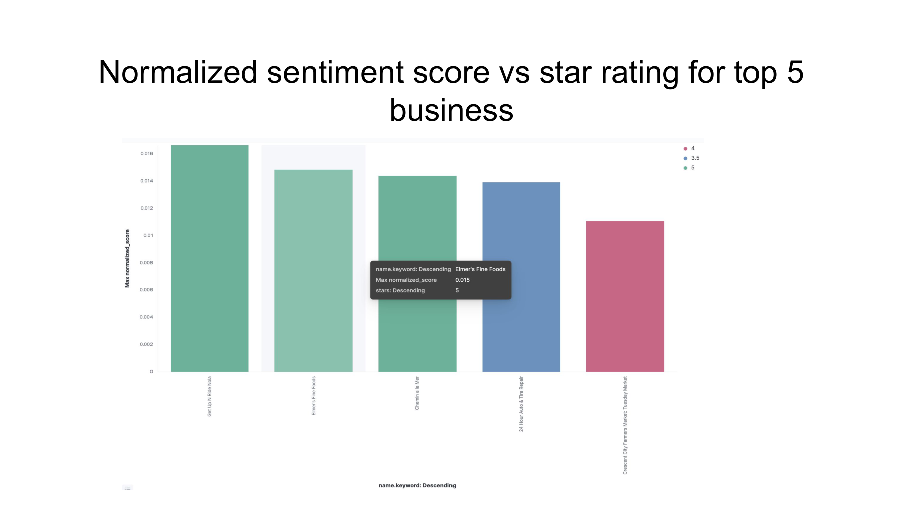
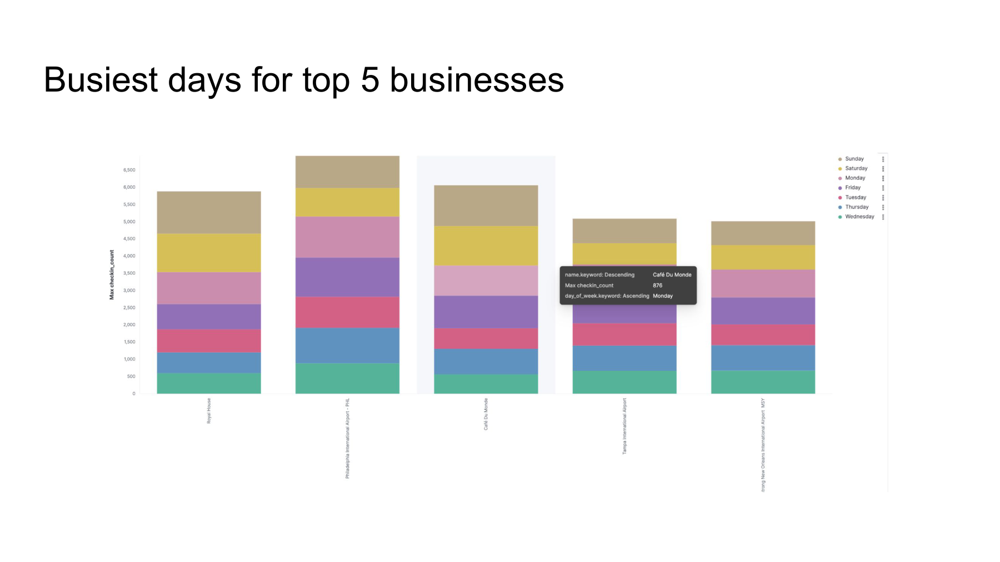

# spark-stream-analysis

Database Systems course project. It takes the Yelp Open Dataset and runs a few
streaming analyses on it with Spark Structured Streaming, then pushes the results
into Elasticsearch so they can be viewed in Kibana.

The Yelp data comes as huge JSON files, so there's a preprocessing step that
converts the reviews to CSV in chunks. Spark reads the business file as a normal
(batch) table and reads the reviews/check-ins as streams, joins them together,
and writes the output to Elasticsearch.

## What it computes

There are three separate jobs, each with its own entry point:

- **Review sentiment** (`business_review_streaming.py`) — runs each review's text
  through NLTK VADER to get a sentiment score, joins it to the business, and adds
  year / month / day-of-week columns. Output index: `review_sentimental`.

- **Weighted score** (`business_weighted_score.py`) — the more interesting one.
  Instead of just averaging sentiment, older reviews are decayed and reviews with
  more "useful" votes count for more:

  ```
  decay_factor   = exp(-0.01 * days_since_review)
  weighted_score = sentiment * (useful + 0.1) * decay_factor
  normalized     = weighted_score / review_count
  ```

  Currently filtered to businesses in Louisiana (`state == "LA"`).
  Output index: `business_weighted_averge`.

- **Busiest day** (`business_checkin_streaming.py`) — counts check-ins per business
  per day-of-week over a rolling window to find when each place is busiest. Also
  buckets each business into a category (Restaurant / Shopping / Hospital / etc).
  Output index: `business_checkin_matrics`.

## Layout

```
config/        Spark session + stream readers + boto3/S3 helper
schemas/       Spark schemas for business, review, check-in CSVs
preprocessing/ Yelp JSON -> CSV conversion (run once before streaming)
udfs/          sentiment, weighted average, category UDFs
processors/    the three analysis jobs
```

## Running it

1. `pip install -r requirements.txt`
2. Copy `.env.example` to `.env` and fill in your values (Spark master,
   data directory, Elasticsearch host/credentials).
3. Convert the raw Yelp JSON to CSV (edit the paths in
   `preprocessing/preprocessCheckin.py` first).
4. Run one of the jobs, e.g.:

   ```
   python business_weighted_score.py
   ```

You need a Spark cluster (or `local[*]`) and a reachable Elasticsearch instance.
The default Spark master is `local[*]` so it runs on one machine if you don't set
`SPARK_MASTER`.

### Reading reviews from Kafka (optional)

By default reviews are read from `review.csv`. If `KAFKA_SERVERS` is set in
`.env`, the review stream is read from a Kafka topic instead. The business data
stays a batch CSV either way (it's just a lookup table).

1. Start a local Kafka broker:

   ```
   docker-compose up -d
   ```

2. Feed the review CSV into the topic:

   ```
   python kafka_producer.py
   ```

3. Run a job with the Kafka connector package on the classpath, e.g.:

   ```
   spark-submit --packages org.apache.spark:spark-sql-kafka-0-10_2.12:3.4.0 business_weighted_score.py
   ```

`config/sparkStreams.py` decides between Kafka and CSV based on whether
`KAFKA_SERVERS` is set. The actual Kafka read is in `kafka_utils.py`.

## Dashboards

Screenshots of the Kibana dashboards are in `screenshots/`:





## Notes / limitations

- Config (hosts, credentials, paths) is read from environment variables — see
  `.env.example`. `.env` is gitignored.
- Reviews can be read either from CSV files on disk or from a Kafka topic (see
  the Kafka section above). Check-ins and business data are still read from files.
- Built against Spark 3.4 and the elasticsearch-spark connector.
# yelp-streaming-analytics
