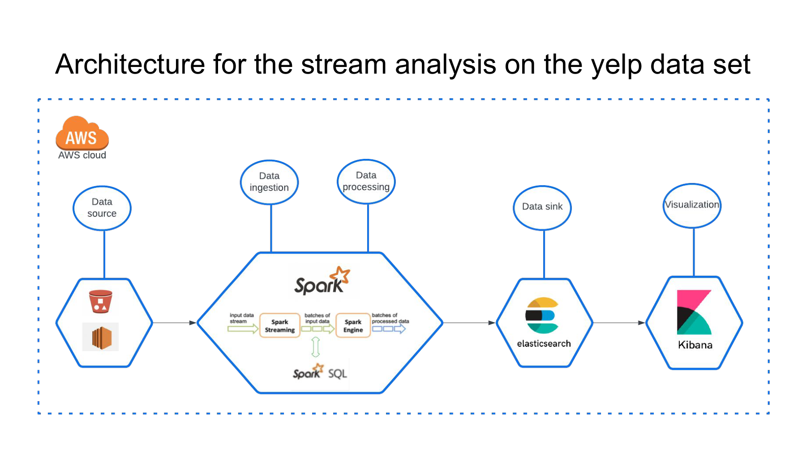
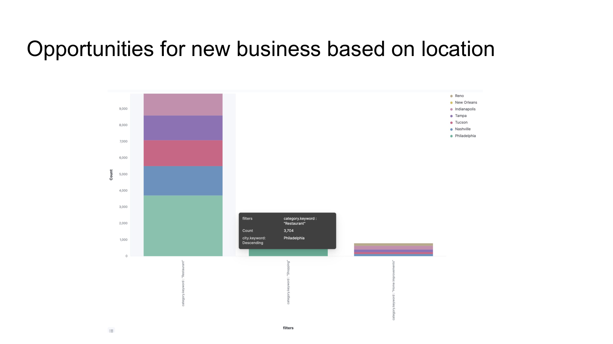
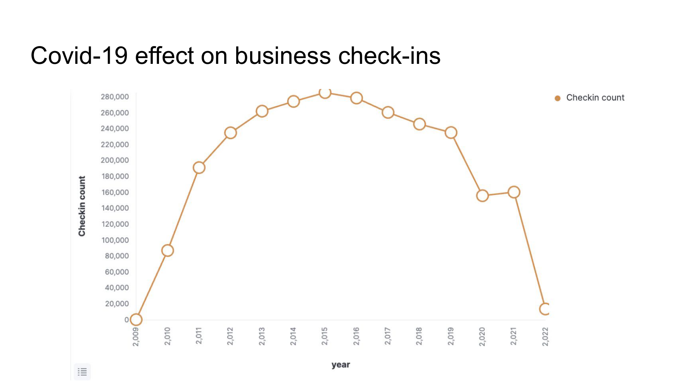

# spark-stream-analysis

Database Systems course project. It runs a set of streaming analytics on the
Yelp Open Dataset with Spark Structured Streaming and pushes the results into
Elasticsearch, where they're visualized in Kibana.

The idea is a business-intelligence use case: businesses want to understand their
customers to use resources better. For example a restaurant figuring out its peak
days, or seeing which business categories are underserved in a given city. Each
analysis reads reviews or check-ins as a stream, joins them against the (static)
business table, and writes the output out for dashboards.

## Data

Uses the [Yelp Open Dataset](https://www.yelp.com/dataset), which ships as large
JSON files (business, review, check-in, tip, user). The review and check-in files
are converted to CSV first (`preprocessing/`) because they're big and CSV was
faster to stream in. Business data is small enough to read as a normal batch table
and is used as a lookup that the streams join against.

## Architecture



Data source on AWS (S3) → Spark Structured Streaming + Spark SQL for the
processing → Elasticsearch as the sink → Kibana for the charts. The original
setup ran on AWS: one Spark master, two Spark workers, and one instance for
Elasticsearch + Kibana, plus an S3 bucket. Hosts and credentials are read from
environment variables now (see `.env.example`).

## The analyses

Each of these is a separate job with its own entry point.

### Busiest day per business

`business_checkin_streaming.py` — streams the check-ins and applies temporal data
analytics (grouping by year / month / day-of-week), counting check-ins per business
per weekday over a rolling window to find when each place is busiest. Output index:
`business_checkin_matrics`.


The busiest places turned out to be airports and Café Du Monde, and weekends
(Saturday/Sunday) dominate the check-in counts.

### Weighted sentiment analysis

`business_weighted_score.py` — the more involved one. It combines sentiment scoring
(NLTK VADER on each review's text), temporal analysis (year / month / day-of-week),
and a decay-based weighting. Instead of a plain average, older reviews decay and
reviews with more "useful" votes count for more.

```
decay_factor   = decay_rate * DATEDIFF(current_timestamp, review_date)
weighted_score = sentiment_score * (useful + 0.1) * decay_factor
normalized     = weighted_score / review_count
```

Output index: `business_weighted_averge`. (Currently filtered to Louisiana,
`state == "LA"`.)


This lets you rank businesses by a recency- and usefulness-aware sentiment score
and compare it against their raw star rating.

There's also a simpler sentiment-only job, `business_review_streaming.py`, which
just scores each review and writes to the `review_sentimental` index without the
weighting.

### Opportunities by location

Using the business categories and cities, you can see which categories are common
or missing in each city — i.e. where there might be a gap for a new business.



Restaurants dominate most cities (e.g. ~3,700 restaurants in Philadelphia), while
categories like Home Improvement are much thinner.

### Covid-19 effect on check-ins

Aggregating check-ins by year shows the pandemic impact clearly.



Check-ins grew steadily, peaked around 2015, and then dropped sharply in 2020–2022.

## Layout

```
config/        Spark session + stream readers + boto3/S3 helper
schemas/       Spark schemas for business, review, check-in CSVs
preprocessing/ Yelp JSON -> CSV conversion (run once before streaming)
udfs/          sentiment, weighted average, category UDFs
processors/    the analysis jobs
```

## Running it

1. `pip install -r requirements.txt`
2. Copy `.env.example` to `.env` and fill in your values (Spark master,
   data directory, Elasticsearch host/credentials).
3. Convert the raw Yelp JSON to CSV (edit the paths in
   `preprocessing/preprocessCheckin.py` first).
4. Run one of the jobs, e.g.:

   ```
   python business_weighted_score.py
   ```

You need a Spark cluster (or `local[*]`) and a reachable Elasticsearch instance.
The default Spark master is `local[*]` so it runs on one machine if you don't set
`SPARK_MASTER`.

### Reading reviews from Kafka (optional)

By default reviews are read from `review.csv`. If `KAFKA_SERVERS` is set in
`.env`, the review stream is read from a Kafka topic instead. The business data
stays a batch CSV either way (it's just a lookup table).

1. Start a local Kafka broker:

   ```
   docker-compose up -d
   ```

2. Feed the review CSV into the topic:

   ```
   python kafka_producer.py
   ```

3. Run a job with the Kafka connector package on the classpath, e.g.:

   ```
   spark-submit --packages org.apache.spark:spark-sql-kafka-0-10_2.12:3.4.0 business_weighted_score.py
   ```

`config/sparkStreams.py` decides between Kafka and CSV based on whether
`KAFKA_SERVERS` is set. The actual Kafka read is in `kafka_utils.py`.

## Notes / limitations

- Config (hosts, credentials, paths) is read from environment variables — see
  `.env.example`. `.env` is gitignored.
- Reviews can be read either from CSV files on disk or from a Kafka topic (see
  the Kafka section above). Check-ins and business data are still read from files.
- Built against Spark 3.4 and the elasticsearch-spark connector.
- The dashboard images above are from the project presentation
  (`Stream processing on yelp dataset.pdf`).
